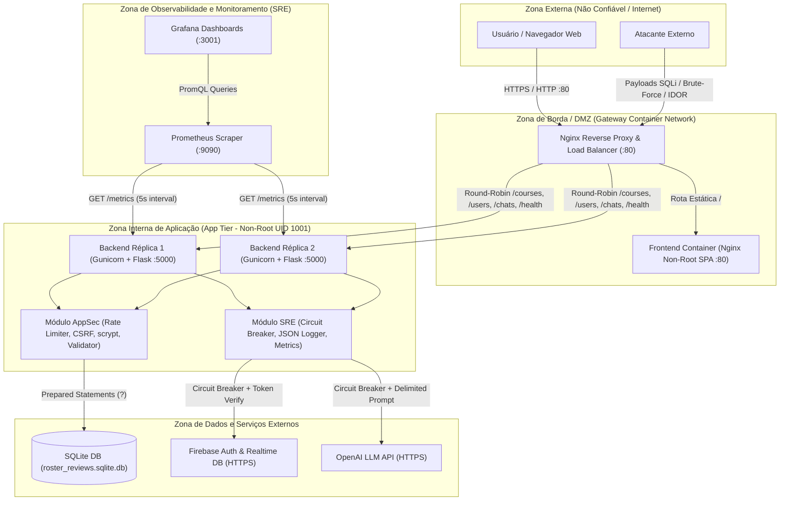

# Relatório Técnico de Pentest Web, Segurança de Aplicações (AppSec) e Engenharia de Confiabilidade (SRE)

---

## 1. Controle de Documento (Document Control)

| Campo | Detalhamento |
|---|---|
| **Título do Documento** | Relatório de Avaliação de Segurança (Pentest Web) e Engenharia de Confiabilidade — CourseSphere |
| **Versão** | `2.2 (Final — Pós-Remediação, Hardening, Consistência Distribuída e Validação Criptográfica Estrita)` |
| **Classificação** | **PÚBLICO — AVALIAÇÃO TÉCNICA (APPSEC & SRE)** |
| **Aplicação Alvo** | CourseSphere (Backend Python/Flask + Frontend React/TypeScript/Vite + SQLite/Firebase/OpenAI) |
| **Autor / Auditor** | Bolsista de Segurança de Aplicações e Confiabilidade (AppSec / SRE) |
| **Data da Avaliação** | 27–28 de Outubro de 2026 |
| **Padrões de Referência** | OWASP Top 10 (2021), OWASP WSTG v4.2, PTES, NIST SP 800-115, FIRST CVSS v3.1, Google SRE |

---

## 2. Sumário Executivo (Executive Summary)

### 2.1 Visão Geral do Engajamento
Este relatório apresenta os resultados consolidados da avaliação técnica de Segurança de Aplicações (**AppSec**) e Engenharia de Confiabilidade (**SRE**) conduzida sobre a plataforma **CourseSphere**. O objetivo do trabalho foi identificar, comprovar com evidências reprodutíveis e corrigir na causa raiz vulnerabilidades reais de segurança, implementar controles proativos de *hardening*, estruturar a observabilidade (logs estruturados em JSON, métricas Prometheus com cardinalidade controlada, SLIs/SLOs) e projetar uma arquitetura conteinerizada escalável com estado compartilhado e balanceamento de carga via Nginx.

A avaliação combinou análise estática automatizada (**SAST** com Bandit e Semgrep), análise de composição de software (**SCA** com `pip-audit`, OSV Scanner e Dependabot), revisão manual de código-fonte (*White-Box*) e testes automatizados de segurança (*Grey-Box*) sobre os fluxos de autenticação, CRUD de cursos, histórico de chats e integração com modelos de linguagem (LLM).

### 2.2 Estatísticas-Chave e Evolução da Postura de Segurança

| Indicador de Segurança e Confiabilidade | Estado Inicial (`main`) | Estado Pós-Intervenção (`fix/security-and-hardening`) |
|---|---|---|
| **Vulnerabilidades Reais Documentadas** | **9 vulnerabilidades** (1 Crítica, 4 Altas, 4 Médias) | **100% Remediadas / Mitigadas na Causa Raiz** |
| **Alertas SAST — Bandit (Backend Python)** | **20 alertas** (1 High, 15 Medium, 4 Low) | **0 alertas** (0 High, 0 Medium, 0 Low em 2.404 LOC) |
| **Alertas SAST — Semgrep (Full-Stack & IaC)** | **24 achados bloqueantes** | **0 achados bloqueantes** |
| **Suíte de Testes Automatizados de Segurança** | **0 testes** | **29 testes automatizados (`pytest`) — 100% Passing** |
| **Postura de Containers e Estado entre Réplicas** | Apenas frontend em `node:16` rodando como `root` | Multi-stage builds **non-root** + Nginx LB (2 réplicas com **volume SQLite WAL compartilhado**) + Manifestos **K8s** |
| **Observabilidade e Resiliência SRE** | Inexistente (`print` statements e erros brutos) | Logs JSON + `/health` + `/metrics` (agregado entre workers e baixa cardinalidade) + **Circuit Breaker** |

### 2.3 Recomendações Estratégicas para Gestão
1. **Substituição do SQLite por Banco Relacional Cliente-Servidor (PostgreSQL)**: Para suportar escrita concorrente em múltiplas réplicas sem contenção de *file locks*.
2. **Gestão Centralizada de Segredos em Nuvem**: Integrar o cluster Kubernetes/Docker ao AWS Secrets Manager ou HashiCorp Vault via *External Secrets Operator*.
3. **Enforcement Contínuo no CI/CD**: Manter o pipeline GitHub Actions (`.github/workflows/security.yml`) como *quality gate* obrigatório bloqueando Pull Requests com falhas em testes de autorização, SAST ou SCA.

---

## 3. Escopo, Objetivos e Regras de Engajamento (Scope & ROE)

### 3.1 Ativos em Escopo (In-Scope Assets)

| Componente | Caminho / Endpoint | Tecnologia |
|---|---|---|
| **API de Cursos (CRUD)** | `GET/POST /courses`, `GET/PUT/DELETE /courses/<id>`, `/courses/semester/*`, `/courses/department/*`, `/courses/instructor/*` | Python 3 / Flask Blueprint + SQLite3 |
| **API de Usuários e Sessão** | `POST /users/create`, `POST /users/login`, `GET/POST /users/info`, `POST /hash` | Flask + Firebase Admin SDK + `scrypt` / HMAC-SHA256 |
| **API de Chat e IA (LLM)** | `POST /users/query`, `POST /chats/<chat_id>/messages`, `DELETE /chats/<chat_id>` | Flask + OpenAI API + Firebase Realtime DB |
| **Pipeline de Dados Reddit** | `backend/cornell-course-sphere-data/reddit-data/data-migrations.py`, `reddit_crawler.py` | Python + PRAW + Pandas + SQLite3 |
| **Aplicação Web Frontend** | `frontend/src/api.ts`, `pages/*`, `components/*`, `package.json` | React 18 + TypeScript + Vite + Material UI |
| **Infraestrutura e Containers** | `backend/Dockerfile`, `frontend/Dockerfile`, `docker-compose.yml`, `docker/nginx/nginx.conf`, `k8s/manifests.yaml` | Docker + Nginx + Prometheus + Grafana + Kubernetes |

### 3.2 Perfis de Acesso Testados (Authenticated Roles Tested)

| Perfil / Role | Credencial / Identificador de Teste | Nível de Privilégio | Escopo de Validação na Auditoria |
|---|---|---|---|
| **Não Autenticado (`Anonymous / Unauthenticated`)** | Sem cabeçalho `Authorization` ou com token inválido/expirado | Nenhum (Público) | Tentativas de acesso não autorizado a `/users/query`, `/courses` (`POST/PUT/DELETE`), `/chats/*`, injeção de SQL em rotas públicas e força bruta em `/users/login`. |
| **Usuário Autenticado Proprietário (`Resource Owner — alice`)** | `Bearer valid_token_alice` (`uid: user_alice`) | Usuário Padrão (Criador do Recurso) | Criação legítima de cursos (`POST /courses`), edição (`PUT /courses/<id>`) e exclusão (`DELETE /courses/<id>`) dos próprios cursos e acesso ao próprio histórico de chats. |
| **Usuário Autenticado Terceiro (`Horizontal Attacker — bob`)** | `Bearer valid_token_bob` (`uid: user_bob`) | Usuário Padrão (Outro Usuário) | Testes de escalonamento horizontal de privilégios (**BOLA / IDOR**): tentativa de editar ou excluir cursos criados por `user_alice` (bloqueado com **`HTTP 403 Forbidden`**) e tentativa de Path Traversal entre chats. |

---

## 4. Metodologia e Modelagem de Ameaças (Threat Modeling — STRIDE)

### 4.1 Metodologia de Avaliação em 5 Fases
A auditoria seguiu o padrão **PTES**, **OWASP WSTG v4.2** e **NIST SP 800-115**:
1. **Fase 1 — Reconhecimento e Mapeamento de Superfície**: Enumeração de rotas Flask, fluxos de dados no frontend React, esquemas SQLite e histórico de commits Git.
2. **Fase 2 — Modelagem de Ameaças (STRIDE) e SAST/SCA**: Execução de Semgrep, Bandit, `pip-audit` e auditoria OSV no `package-lock.json`.
3. **Fase 3 — Exploração Controlada e Validação (PoC)**: Construção de provas de conceito reprodutíveis comprovando o impacto real de cada falha.
4. **Fase 4 — Engenharia Defensiva, Correção de Causa Raiz e Hardening**: Refatoração segura com commits atômicos e suíte de regressão automatizada.
5. **Fase 5 — Engenharia de Confiabilidade (SRE) e Escalabilidade**: Instrumentação de logs JSON, métricas OpenMetrics, SLIs/SLOs, Circuit Breaker e balanceamento de carga.

### 4.2 Diagrama de Fluxo de Dados (DFD) e Fronteiras de Confiança



### 4.3 Matriz de Modelagem de Ameaças (STRIDE)

| Categoria STRIDE | Ameaça Identificada no CourseSphere | Componente Afetado | Vulnerabilidade Associada | Controle / Mitigação Implementada |
|---|---|---|---|---|
| **S — Spoofing** (Falsificação de Identidade) | Captura de token JWT exposto em URL GET (`?id_token=`) ou força bruta em login. | `GET /users/info`, `POST /users/login` | **PT-005** | Transporte estrito via header `Authorization: Bearer`, bloqueio de tokens na URL (HTTP 401), hashing `scrypt` e lockout após 5 falhas (HTTP 429). |
| **T — Tampering** (Adulteração de Dados) | Adulteração ou exclusão de cursos/chats de terceiros; injeção de comandos SQL. | `PUT/DELETE /courses/<id>`, `/chats/<id>`, `db.py` | **PT-001**, **PT-002** | Consultas 100% parametrizadas (`?`), validação de posse `course["creator_uid"] == uid` (HTTP 403) e regex anti-Path Traversal. |
| **R — Repudiation** (Repúdio) | Execução de ações críticas (exclusão de cursos, falhas de login) sem trilha de auditoria. | Todos os endpoints da API | Requisito 4 (SRE) | Logging estruturado em JSON com `timestamp`, `request_id` (UUIDv4), `instance_id`, `event_type`, `status_code` e `duration_ms`. |
| **I — Information Disclosure** (Vazamento de Dados) | Exposição do debugger Werkzeug (`debug=True`), stacktraces em exceções e chaves de API no Git. | `endpoints.py`, `reddit_key.json`, `firebaseConfig.ts` | **PT-003**, **PT-004** | `FLASK_DEBUG=0` por padrão, handlers globais 404/500 sanitizados e remoção de segredos hardcoded para variáveis de ambiente. |
| **D — Denial of Service** (Negação de Serviço) | Exaustão de cota da OpenAI sem autenticação, inundação de requests (flood) ou travamento por falha externa. | `POST /users/query`, API Global | **PT-002**, **PT-007** | Autenticação obrigatória em `/users/query`, Rate Limiter por IP (60 req/min), **Circuit Breaker** e múltiplas réplicas com Gunicorn + Nginx. |
| **E — Elevation of Privilege** (Elevação de Privilégio) | Execução de código como `root` dentro do container web ou RCE via console Werkzeug. | `frontend/Dockerfile`, `backend/Dockerfile`, `endpoints.py` | **PT-004** | Containers rodando com usuários desprivilegiados (`appuser` UID 1001 e `nginx` UID 101) e `allowPrivilegeEscalation: false` no Kubernetes. |

---

## 5. Resumo das Vulnerabilidades (Findings Summary)

### 5.1 Distribuição por Categoria OWASP Top 10 (2021)

Cada um dos 9 achados documentados (`PT-001` a `PT-009`) é classificado em sua categoria primária do OWASP Top 10 (2021), totalizando exatamente **9 vulnerabilidades**:

| Categoria OWASP Top 10 (2021) | IDs dos Achados | Qtd. de Achados | Maior Severidade | Status |
|---|---|---|---|---|
| **A01:2021 — Broken Access Control** | `PT-002` | **1** | **Alta (8.1)** | ✅ Corrigido |
| **A02:2021 — Cryptographic Failures** | `PT-007` | **1** | **Média (5.3)** | ✅ Corrigido |
| **A03:2021 — Injection (SQLi & Prompt Injection)** | `PT-001`, `PT-009` | **2** | **Crítica (9.8)** | ✅ Corrigido |
| **A05:2021 — Security Misconfiguration** | `PT-004`, `PT-008` | **2** | **Alta (8.8)** | ✅ Corrigido |
| **A06:2021 — Vulnerable and Outdated Components** | `PT-006` | **1** | **Alta (7.5)** | ✅ Corrigido |
| **A07:2021 — Identification and Authentication Failures** | `PT-003`, `PT-005` | **2** | **Alta (7.5)** | ✅ Corrigido |
| **Total Consolidado** | `PT-001` a `PT-009` | **9** | **Crítica (9.8)** | **9 / 9 Corrigidos** |

### 5.2 Tabela Consolidada de Vulnerabilidades

| ID | Título da Vulnerabilidade | Ativo / Componente | Categoria OWASP | CWE | Severidade | CVSS v3.1 | Status |
|---|---|---|---|---|---|---|---|
| **PT-001** | Injeção de SQL (SQL Injection) em Rotas de Cursos e Migrações | `backend/blueprints/courses.py`, `db.py`, `data-migrations.py` | A03:2021 – Injection | CWE-89 | **Crítica** | **9.8** | ✅ Corrigido |
| **PT-002** | Controle de Acesso Quebrado (BOLA/IDOR, Path Traversal em Chats e Falta de Auth em `/users/query`) | `backend/endpoints.py`, `firebase.py`, `courses.py` | A01:2021 – Broken Access Control | CWE-22 / CWE-306 / CWE-639 | **Alta** | **8.1** | ✅ Corrigido |
| **PT-003** | Exposição de Credenciais Hardcoded no Repositório Git | `reddit_key.json`, `firebaseConfig.ts` | A07:2021 – Auth Failures | CWE-798 | **Alta** | **7.5** | ✅ Corrigido |
| **PT-004** | Modo Debug Werkzeug Ativo (`debug=True`), Vazamento de Stacktrace e Container Root | `backend/endpoints.py`, `frontend/Dockerfile` | A05:2021 – Security Misconfig | CWE-94 / CWE-209 / CWE-250 | **Alta** | **8.8** | ✅ Corrigido |
| **PT-005** | Vazamento de Token JWT em URL Query String (GET) e Bug de Promise no Cliente | `backend/endpoints.py`, `frontend/src/api.ts` | A07:2021 – Auth Failures | CWE-598 | **Média** | **6.5** | ✅ Corrigido |
| **PT-006** | Uso de Dependências Vulneráveis no Frontend (Rollup XSS, Vite File Read, Cross-Spawn ReDoS) | `frontend/package.json`, `package-lock.json` | A06:2021 – Vulnerable Components | CWE-1395 | **Alta** | **7.5** | ✅ Corrigido |
| **PT-007** | Criptografia Fraca e Uso de PRNG Não-Criptográfico (`random`) em `/hash` | `backend/main.py` (`hashFunction`) | A02:2021 – Cryptographic Failures | CWE-330 / CWE-328 | **Média** | **5.3** | ✅ Corrigido |
| **PT-008** | Política CORS Irrestrita (`*`), Ausência de Headers HTTP, CSRF e Rate Limiting | `backend/endpoints.py` | A05:2021 – Security Misconfig | CWE-942 / CWE-352 / CWE-307 | **Média** | **6.5** | ✅ Corrigido |
| **PT-009** | Injeção de Prompt (Prompt Injection) e Reflexão de Entrada Não Sanitizada | `backend/main.py`, `query_manager.py`, `frontend/src/api.ts` | A03:2021 / LLM01 | CWE-20 / CWE-79 | **Média** | **6.5** | ✅ Corrigido |

---

## 6. Detalhamento Técnico das Vulnerabilidades (Detailed Findings)

---

### PT-001: Injeção de SQL (SQL Injection) em Consultas de Cursos e Migrações de Dados
- **Severidade**: **Crítica**
- **CVSS 3.1 Base Score**: **9.8** — `CVSS:3.1/AV:N/AC:L/PR:N/UI:N/S:U/C:H/I:H/A:H`
- **Categoria OWASP**: A03:2021 – Injection
- **CWE**: CWE-89 (Improper Neutralization of Special Elements used in an SQL Command)
- **Ativos Afetados**:
  - `CourseSphere/backend/blueprints/courses.py` (linhas 30, 47, 64, 80, 96, 112)
  - `CourseSphere/backend/db.py` (linhas 6–12)
  - `CourseSphere/backend/cornell-course-sphere-data/reddit-data/data-migrations.py` (linhas 169–255)
- **Método HTTP**: `GET`

#### Descrição Técnica e Contexto no Estado Original (`main`)
No commit original de referência (`main: 71616a0`), todas as 6 rotas do módulo [`backend/blueprints/courses.py`](backend/blueprints/courses.py) interpolavam parâmetros controlados pelo usuário (`semester`, `department`, `instructor`, `course_id`, `section_id`) diretamente na string SQL via *f-strings* (`f"SELECT * FROM courses WHERE semester = '{semester}'"`), e [`backend/db.py`](backend/db.py) executava `cursor.execute(query)` sem *prepared statements* (detectado pelo Bandit como `15x B608 hardcoded_sql_expressions` e pelo Semgrep como `formatted-sql-query`). Adicionalmente, em [`data-migrations.py`](backend/cornell-course-sphere-data/reddit-data/data-migrations.py), `update_post(post_id, **kwargs)` interpolava dinamicamente chaves arbitrárias de `kwargs` como nomes de colunas SQL.

> **Nota Factual de Arquitetura (`main`)**: Na versão original de `backend/endpoints.py` (linha 10), a linha `#app.register_blueprint(courses_bp)` encontrava-se comentada (`# TODO: figure out the blueprint thing below`). Assim, a vulnerabilidade estava latente no módulo `courses.py` e no script `data-migrations.py`, tornando-se imediatamente explorável via HTTP assim que o blueprint de cursos é registrado para atender ao requisito funcional de CRUD/consulta de cursos da aplicação.

#### Passos de Reprodução e Evidência (Antes vs. Depois)
1. **Estado Vulnerável (Antes da Parametrização)**:
   Com o blueprint original (`main:backend/blueprints/courses.py`) registrado sem parametrização, ao enviar o payload `' OR '1'='1` ou `' UNION SELECT ... --`:
   ```http
   GET /courses/semester/'%20OR%20'1'='1 HTTP/1.1
   Host: localhost:5000
   ```
   A string SQL avaliada pelo SQLite torna-se:
   ```sql
   SELECT * FROM courses WHERE semester = '' OR '1'='1'
   ```
   **Resultado observado antes da correção (`HTTP 200 OK`)**: A condição `'1'='1'` avalia como verdadeira para todas as linhas e a API retorna o dump completo de todos os cursos cadastrados no banco independentemente do semestre:
   ```json
   [
     [1, "AppSec 101", 101, "Fall2026", "CS", "Dr. Turing"],
     [2, "Data Structures", 102, "Spring2026", "CS", "Dr. Knuth"]
   ]
   ```
2. **Estado Corrigido (`fix/security-and-hardening`)**:
   Repetindo exatamente a mesma requisição contra o código parametrizado:
   ```http
   GET /courses/semester/'%20OR%20'1'='1 HTTP/1.1
   Host: localhost:5000
   ```
   **Resultado observado após a correção (`HTTP 404 NOT FOUND`)**: O payload é vinculado como literal de dados pelo driver SQLite (`WHERE semester = ?`), neutralizando a tautologia SQL e confirmando a correção nos testes `test_sql_injection_in_semester_parameter` e `test_sql_injection_union_based`:
   ```http
   HTTP/1.1 404 NOT FOUND
   Content-Type: application/json
   X-Content-Type-Options: nosniff
   X-Frame-Options: DENY

   {"error": "No courses found for this semester"}
   ```

#### Impacto para o Negócio
A exposição das rotas de cursos sem parametrização permite que qualquer usuário não autenticado extraia todas as tabelas do banco SQLite (incluindo `sqlite_master` e tabelas de usuários/chats via `UNION SELECT`) ou corrompa registros no script de migração.

#### Causa Raiz e Solução Implementada (Commit `54a7037`)
A causa raiz era a concatenação direta de strings SQL com dados não confiáveis. A solução refatorou `execute_query(query: str, params: tuple = ())` em [`backend/db.py`](backend/db.py) para exigir consultas parametrizadas (`?`) da DB-API 2.0 do SQLite, e substituiu todas as consultas em [`backend/blueprints/courses.py`](backend/blueprints/courses.py) e [`data-migrations.py`](backend/cornell-course-sphere-data/reddit-data/data-migrations.py) por SQL 100% estático:
```python
# Antes (Vulnerável):
courses = execute_query(f"SELECT * FROM courses WHERE semester = '{semester}'").fetchall()

# Depois (Seguro — Prepared Statement):
courses = execute_query("SELECT * FROM courses WHERE semester = ?", (semester,))
```

---

### PT-002: Controle de Acesso Quebrado (BOLA/IDOR, Path Traversal em Chats e Ausência de Autenticação em `/users/query`)
- **Severidade**: **Alta**
- **CVSS 3.1 Base Score**: **8.1** — `CVSS:3.1/AV:N/AC:L/PR:L/UI:N/S:U/C:N/I:H/A:H`
- **Categoria OWASP**: A01:2021 – Broken Access Control
- **CWE**: CWE-22 (Path Traversal), CWE-306 (Missing Authentication for Critical Function), CWE-639 (Authorization Bypass Through User-Controlled Key)
- **Ativos Afetados**:
  - `CourseSphere/backend/endpoints.py` (`POST /users/query`, `POST /chats/<chat_id>/messages`, `DELETE /chats/<chat_id>`)
  - `CourseSphere/backend/firebase.py` (`save_chat`, `delete_chat`, `update_document`, `delete_document`)
  - `CourseSphere/backend/blueprints/courses.py` (`PUT /courses/<id>`, `DELETE /courses/<id>`)

#### Descrição Técnica
Foram identificados três vetores de falha de controle de acesso:
1. **Path Traversal / BOLA no Firebase Realtime Database**: Em `save_chat` e `delete_chat`, o parâmetro `chat_id` era concatenado sem validação em `db.reference(f"users/{uid}/chats/{chat_id}")`. Caracteres de travessia (`..`) permitiam referenciar nós de outros usuários na árvore JSON do Firebase (`users/<vitima>/chats/...`).
2. **Ausência de Autenticação em `/users/query` (`CWE-306`)**: O endpoint `POST /users/query` chamava `Firebase.try_get_user_info(id_token)`, que engolia falhas de verificação de token (`except Exception: return None`) e permitia que requisições sem qualquer autenticação acionassem `QueryManager` e consumissem créditos da API da OpenAI.
3. **Controle de Acesso por Criador no CRUD de Cursos**: Na gestão de cursos (`POST`, `PUT`, `DELETE /courses/<id>`), é indispensável garantir que apenas o criador (`creator_uid`) possa editar ou excluir seu curso.

#### Passos de Reprodução e Evidência HTTP
1. Tentativa de edição de curso do usuário `alice` pelo usuário `bob`:
```http
PUT /courses/1 HTTP/1.1
Host: localhost:5000
Authorization: Bearer csjwt.<payload_bob>.<hmac_sig>
Content-Type: application/json

{"name": "Curso Adulterado por Bob"}
```
Resposta do servidor remediado:
```http
HTTP/1.1 403 FORBIDDEN
Content-Type: application/json

{"error": "Forbidden: You do not have permission to edit a course created by another user."}
```
2. Tentativa de Path Traversal em `chat_id`:
```http
POST /chats/..%2F..%2Fvictim_uid/messages HTTP/1.1
Host: localhost:5000
Authorization: Bearer csjwt.<payload_alice>.<hmac_sig>
Content-Type: application/json

{"messages": [{"sender": "user", "content": "overwrite"}]}
```
Resposta: `HTTP/1.1 400 BAD REQUEST` (`{"error": "Invalid Chat ID: must contain only alphanumeric, underscore, or hyphen characters."}`).

#### Impacto para o Negócio
Modificação ou destruição não autorizada de cursos e históricos de conversas de outros usuários, além de exaustão financeira da conta OpenAI por chamadas anônimas automatizadas.

#### Causa Raiz e Solução Implementada
- Implementação de `validate_path_identifier()` em [`backend/firebase.py`](backend/firebase.py) aplicando regex estrita `^[a-zA-Z0-9_\-]{1,128}$` em todos os identificadores (`uid`, `chat_id`, `collection`, `document_id`).
- Exigência de token Bearer válido em `POST /users/query` ([`backend/endpoints.py`](backend/endpoints.py)).
- Verificação explícita de propriedade `course.get("creator_uid") != uid` retornando `HTTP 403 Forbidden` em `PUT /courses/<id>` e `DELETE /courses/<id>` ([`backend/blueprints/courses.py`](backend/blueprints/courses.py)), validada pelo teste automatizado `test_course_authorization_owner_vs_other_user`.

---

### PT-003: Exposição de Credenciais Hardcoded no Controle de Versão
- **Severidade**: **Alta**
- **CVSS 3.1 Base Score**: **7.5** — `CVSS:3.1/AV:N/AC:L/PR:N/UI:N/S:U/C:H/I:N/A:N`
- **Categoria OWASP**: A07:2021 – Identification and Authentication Failures / A02:2021 – Cryptographic Failures
- **CWE**: CWE-798 (Use of Hard-coded Credentials)
- **Ativos Afetados**:
  - `CourseSphere/backend/cornell-course-sphere-data/reddit-data/reddit_key.json`
  - `CourseSphere/frontend/src/firebaseConfig.ts`
  - `CourseSphere/docker-compose.yml` / `backend/security.py`

#### Descrição Técnica
O arquivo `reddit_key.json` continha credenciais reais da API do Reddit (`client_id` e `client_secret`) versionadas em texto claro no repositório, e `firebaseConfig.ts` continha chaves fixas sem suporte a variáveis de ambiente. Além disso, chaves de assinatura de sessão (`COURSESPHERE_SECRET_KEY`) nunca devem possuir valores literais fixos em arquivos de orquestração (`docker-compose.yml`) ou código-fonte.

#### Passos de Reprodução
```bash
git show main:backend/cornell-course-sphere-data/reddit-data/reddit_key.json
```

#### Impacto para o Negócio
Comprometimento imediato de credenciais de integração com APIs de terceiros e possibilidade de falsificação de tokens de sessão caso a chave de assinatura HMAC seja conhecida publicamente.

#### Causa Raiz e Solução Implementada (Commit `dbaa49b` e revisão de segredos)
Remoção dos valores sensíveis, criação de [`.env.example`](.env.example) documentando todas as variáveis de ambiente e refatoração de [`reddit_crawler.py`](backend/cornell-course-sphere-data/reddit-data/reddit_crawler.py), [`firebaseConfig.ts`](frontend/src/firebaseConfig.ts), [`backend/security.py`](backend/security.py) e [`docker-compose.yml`](docker-compose.yml). A função `get_secret_key()` em [`backend/security.py`](backend/security.py) falha de forma segura (*fail-closed* com `RuntimeError`, validado por `test_production_mode_fails_without_secret_key`) caso `COURSESPHERE_SECRET_KEY` não esteja definida em produção (`COURSESPHERE_ENV=production`), e em modo de desenvolvimento sincroniza uma chave efêmera gerada via CSPRNG (`secrets.token_hex(32)`) na tabela compartilhada `app_config` sem nenhuma string estática no código.
> **Nota de Resposta a Incidentes (Histórico Git)**: Como a branch `main` original é mantida inalterada para fins de avaliação comparativa do desafio técnico, em um ambiente real de produção qualquer credencial historicamente versionada no Git (`reddit_key.json`) deve ser **imediatamente revogada e rotacionada** no console do provedor (Reddit API / Firebase Console), pois a remoção em novos commits não apaga objetos em commits anteriores.

---

### PT-004: Modo Debug Werkzeug Ativo (`debug=True`), Vazamento de Stacktrace e Execução de Container como `root`
- **Severidade**: **Alta**
- **CVSS 3.1 Base Score**: **8.8** — `CVSS:3.1/AV:N/AC:L/PR:N/UI:N/S:U/C:H/I:H/A:H`
- **Categoria OWASP**: A05:2021 – Security Misconfiguration
- **CWE**: CWE-94 (Code Injection / Debugger Exposure), CWE-209 (Error Message Containing Sensitive Information), CWE-250 (Execution with Unnecessary Privileges)
- **Ativos Afetados**:
  - `CourseSphere/backend/endpoints.py` (linha 108 e blocos `except`)
  - `CourseSphere/frontend/Dockerfile` (linha 24)

#### Descrição Técnica
1. O servidor Flask era iniciado com `app.run(debug=True)`. Em produção, isso expõe o depurador interativo do Werkzeug, que exibe variáveis locais, código-fonte e permite execução remota de comandos Python (RCE).
2. Todos os endpoints retornavam `str(e)` diretamente na resposta JSON (`return error_response(f"Error ...: {str(e)}", 400)`), expondo detalhes internos de banco de dados e sistema de arquivos.
3. O `Dockerfile` do frontend não especificava a diretiva `USER`, executando o processo do container como `root` (UID 0).

#### Causa Raiz e Solução Implementada (Commits `92d810d` e `aa39e5a`)
- Desativação de `debug=True` por padrão (`FLASK_DEBUG=0`) e adoção do servidor WSGI de produção **Gunicorn** no container.
- Substituição das respostas de erro por mensagens genéricas padronizadas no cliente, mantendo o detalhe técnico apenas no log JSON estruturado interno.
- Configuração de usuários não-root tanto no backend (`USER appuser`, UID 1001) quanto no frontend (`USER nginx`, UID 101) e nos manifestos Kubernetes (`runAsNonRoot: true`, `allowPrivilegeEscalation: false`).

---

### PT-005: Vazamento de Token JWT em URL Query String (GET) e Envio de Promise Não Resolvida
- **Severidade**: **Média**
- **CVSS 3.1 Base Score**: **6.5** — `CVSS:3.1/AV:N/AC:L/PR:N/UI:R/S:U/C:H/I:N/A:N`
- **Categoria OWASP**: A07:2021 – Identification and Authentication Failures
- **CWE**: CWE-598 (Use of GET Request with Sensitive Query Strings)
- **Ativos Afetados**:
  - `CourseSphere/backend/endpoints.py` (`GET /users/info`, linha 58)
  - `CourseSphere/frontend/src/api.ts` (linhas 91 e 184)

#### Descrição Técnica
1. O cliente React enviava o token JWT na URL via método `GET` (`fetch("http://127.0.0.1:5000/users/info?id_token=" + idToken)`), e o backend lia `request.args.get("id_token")`. Parâmetros de URL ficam gravados em texto claro em logs de proxies reversos (Nginx), histórico do navegador e cabeçalhos `Referer`.
2. Na função `fetchCourseSphereResponse` (`api.ts` L184), a chamada `user?.getIdToken()` foi feita sem `await`, enviando `Authorization: Bearer [object Promise]` no cabeçalho HTTP.

#### Evidência HTTP Pós-Correção
```http
GET /users/info?id_token=test-token-alice HTTP/1.1
Host: localhost:5000
```
Resposta:
```http
HTTP/1.1 401 UNAUTHORIZED
Content-Type: application/json

{"error": "Insecure token transport: tokens must be transmitted in the Authorization HTTP header, not query parameters."}
```

#### Causa Raiz e Solução Implementada (Commit `92d810d`)
- Bloqueio explícito de tokens na query string em `get_auth_token()` com retorno `HTTP 401` e alerta de auditoria nos logs.
- Atualização de `frontend/src/api.ts` para usar `await user?.getIdToken()` e enviar o token exclusivamente via cabeçalho `Authorization: Bearer <token>`.

---

### PT-006: Uso de Dependências Vulneráveis no Frontend (SCA)
- **Severidade**: **Alta**
- **CVSS 3.1 Base Score**: **7.5** — `CVSS:3.1/AV:N/AC:L/PR:N/UI:N/S:U/C:N/I:N/A:H`
- **Categoria OWASP**: A06:2021 – Vulnerable and Outdated Components
- **CWE**: CWE-1395 (Dependency on Vulnerable Third-Party Component)
- **Ativos Afetados**: `CourseSphere/frontend/package.json` e `package-lock.json`

#### Descrição Técnica e Evidência SCA (OSV Database)
A varredura SCA sobre o árvore de dependências do frontend revelou pacotes com vulnerabilidades de alta severidade:
- **`rollup@4.18.0`**: `GHSA-gcx4-mw62-g8wm` (`CVE-2024-45812`) — *DOM Clobbering Gadget leading to Cross-Site Scripting (XSS)*.
- **`vite@5.3.3`**: `GHSA-64vr-g452-qvp3` (DOM Clobbering XSS) e `GHSA-4r4m-qw57-chr8` (*Arbitrary File Read via `@fs` bypass*).
- **`react-router@6.24.1` / `@remix-run/router@1.17.1`**: `GHSA-2w69-qvjg-hvjx` (XSS via Open Redirects).
- **`cross-spawn@7.0.3`**: `GHSA-3xgq-45jj-v275` (`CVE-2024-21538`, High Severity ReDoS).
- **`micromatch@4.0.7`**: `GHSA-952p-6rrq-rcjv` (`CVE-2024-4067`, ReDoS).

#### Solução Implementada
Atualização das versões diretas (`vite@^5.4.11`, `react-router-dom@^6.28.0`, `firebase@^10.14.1`) e adição da diretiva `"overrides"` em [`frontend/package.json`](frontend/package.json) forçando versões corrigidas (`rollup@^4.22.4`, `cross-spawn@^7.0.5`, `micromatch@^4.0.8`, `@remix-run/router@^1.21.0`).

---

### PT-007: Criptografia Fraca e Uso de PRNG Não-Criptográfico (`random`) em `/hash`
- **Severidade**: **Média**
- **CVSS 3.1 Base Score**: **5.3** — `CVSS:3.1/AV:N/AC:L/PR:N/UI:N/S:U/C:N/I:L/A:N`
- **Categoria OWASP**: A02:2021 – Cryptographic Failures
- **CWE**: CWE-330 (Use of Insufficiently Random Values), CWE-328 (Use of Weak Hash)
- **Ativo Afetado**: `CourseSphere/backend/main.py` (`hashFunction`, linhas 14–19)

#### Descrição Técnica
A função `hashFunction` utilizava o módulo padrão `random` (`rv.choices`, `rv.randint`, `rv.shuffle`) baseado no algoritmo Mersenne Twister (totalmente previsível após observação de 624 saídas e inadequado para uso criptográfico, detectado pelo Bandit como `B311`).

#### Solução Implementada (Commit `dbaa49b`)
Substituição por **HMAC-SHA256** (`hmac.new`) combinado com salt gerado por CSPRNG (`secrets.token_hex(8)`) e chave secreta obtida via `get_secret_key()`.

---

### PT-008: Política CORS Irrestrita (`*`), Ausência de Headers HTTP, CSRF e Rate Limiting
- **Severidade**: **Média**
- **CVSS 3.1 Base Score**: **6.5** — `CVSS:3.1/AV:N/AC:L/PR:N/UI:R/S:U/C:L/I:L/A:L`
- **Categoria OWASP**: A05:2021 – Security Misconfiguration
- **CWE**: CWE-942 (Permissive CORS Policy), CWE-352 (CSRF), CWE-307 (Improper Restriction of Excessive Authentication Attempts)
- **Ativo Afetado**: `CourseSphere/backend/endpoints.py`

#### Descrição Técnica
A aplicação habilitava `CORS(app)` permitindo qualquer origem (`*`), não enviava cabeçalhos HTTP de defesa em profundidade, não validava `Origin`/`Content-Type` em requisições que alteram estado (`POST`, `PUT`, `DELETE`) e não possuía limite de taxa de requisições (*Rate Limiting*) ou bloqueio contra força bruta.

#### Solução Implementada
Implementação do módulo [`backend/security.py`](backend/security.py) integrado aos hooks `@app.before_request` e `@app.after_request` em [`backend/endpoints.py`](backend/endpoints.py):
1. **CORS Restrito**: Lista explícita de origens via `ALLOWED_ORIGINS`.
2. **Headers de Segurança HTTP**: `Content-Security-Policy`, `Strict-Transport-Security` (emitido em conexões HTTPS / TLS ou quando habilitado), `X-Content-Type-Options: nosniff`, `X-Frame-Options: DENY`, `Referrer-Policy` e `Permissions-Policy`.
3. **Rate Limiting e Lockout Compartilhado anti-Spoofing**: Limite de 60 req/min por IP e bloqueio automático por 300s (`HTTP 429` + `Retry-After`) após 5 tentativas de autenticação malsucedidas, **persistidos no banco SQLite WAL compartilhado (`rate_limit_events` e `auth_lockouts`) entre todos os workers do Gunicorn e réplicas de containers**. Adicionalmente, o gateway Nginx sobrescreve `X-Real-IP` e `X-Forwarded-For` com `$remote_addr` e `_get_client_ip()` ignora cabeçalhos `X-Forwarded-For` de origens não confiáveis, impedindo bypass de Rate Limiting por falsificação de IP (comprovado pelo teste `test_rate_limit_cannot_be_bypassed_via_x_forwarded_for_spoofing`).
4. **Proteção CSRF**: Rejeição de payloads form-encoded (`HTTP 415`) e de cabeçalhos `Origin` não confiáveis (`HTTP 403`) em rotas `POST`/`PUT`/`DELETE`.

---

### PT-009: Injeção de Prompt (Prompt Injection) em `main.py`/`query_manager.py` e Reflexão de Entrada no Frontend
- **Severidade**: **Média**
- **CVSS 3.1 Base Score**: **6.5** — `CVSS:3.1/AV:N/AC:L/PR:L/UI:N/S:U/C:L/I:L/A:N`
- **Categoria OWASP**: A03:2021 – Injection / OWASP LLM01: Prompt Injection
- **CWE**: CWE-20 (Improper Input Validation), CWE-79 (Cross-site Scripting)
- **Ativos Afetados**: `CourseSphere/backend/main.py`, `backend/query_manager.py`, `frontend/src/api.ts`

#### Descrição Técnica e Estado Original (`main`)
No commit original (`main: 71616a0`):
1. Em [`backend/main.py`](backend/main.py) (linhas 28–55), a função `get_query_details(query)` executava uma chamada real de completude legada (`client.completions.create(model="gpt-3.5-turbo-instruct", prompt=make_prompt(query))`) concatenando a string `query` diretamente nas instruções do sistema sem separação de papéis (`system` vs. `user`) e sem validar o schema JSON retornado.
2. Em [`backend/query_manager.py`](backend/query_manager.py), o método `generate_prompt()` também interpolava `self.query` sem delimitadores, embora a chamada `client.completions.create` em `classify_query_type()` estivesse comentada no código original (retornando `"Fake implementation"`).
3. Em [`frontend/src/api.ts`](frontend/src/api.ts) (linha 207), o bloco `catch` refletia o texto bruto de `query` na mensagem de erro renderizada ao usuário.

#### Solução Implementada
1. **Separação Estrutural de Papéis (`system` / `user`) e Delimitadores `<user_query>`**: Em [`backend/main.py`](backend/main.py) e [`backend/query_manager.py`](backend/query_manager.py), a integração com a OpenAI foi migrada para `client.chat.completions.create` com mensagem `role: "system"` isolada das entradas não confiáveis delimitadas por `<user_query>...</user_query>`.
2. **Validação Estrita da Saída do Modelo (*Output Allowlist Validation*)**: A resposta JSON do modelo é validada contra o conjunto de `allowed_types` permitido (`course_search`, `general`, `unsupported`) e o dicionário `parameters` passa por `validate_query_parameters()`, que filtra apenas chaves previstas no schema (`query_types.json`) e sanitiza valores escalares (`sanitize_string`); qualquer tentativa de injeção que altere a estrutura do JSON ou invente um `query_type` não autorizado é descartada com fallback seguro para `unsupported`. Quando `OPENAI_API_KEY` não está configurada (ex.: ambiente de testes offline), `QueryManager` opera de forma determinística local sem falhar.
3. **Sanitização de Entrada e Remoção de Reflexão**: Aplicação de `sanitize_string()` (`html.escape` + limite de 1.000 caracteres) e remoção da reflexão bruta no `catch` de [`frontend/src/api.ts`](frontend/src/api.ts).

---

## 7. Hardening Básico e Avançado Implementado (Requisito 3)

Embora o edital exigisse no mínimo **2 melhorias** de hardening não previstas na especificação funcional original, foram implementadas **5 camadas completas de hardening** em [`backend/security.py`](backend/security.py) e [`backend/endpoints.py`](backend/endpoints.py):

1. **Rate Limiting Compartilhado e Bloqueio Automático após Tentativas de Login Malsucedidas**:
   - Algoritmo *sliding-window* persistido no banco SQLite WAL compartilhado (`rate_limit_events`), limitando chamadas gerais por IP (`RATE_LIMIT_PER_MINUTE=60`, expondo o header `X-RateLimit-Remaining`) e aplicando limite máximo de payload (`MAX_CONTENT_LENGTH = 1 MB`, `HTTP 413`).
   - Contador compartilhado de falhas de autenticação (`auth_lockouts`) por IP e por conta (`acct:<email>`) que bloqueia temporariamente por 5 minutos (`AUTH_LOCKOUT_SECONDS=300`) após 5 falhas consecutivas em qualquer worker/réplica, retornando `HTTP 429 Too Many Requests` com cabeçalho `Retry-After` e validação estrita de sub-redes confiáveis RFC 1918 via `ipaddress.ip_network` contra spoofing de `X-Forwarded-For`.
2. **Headers de Segurança HTTP Completos**:
   - `Content-Security-Policy: default-src 'self'; script-src 'self'; style-src 'self' 'unsafe-inline'; object-src 'none'; frame-ancestors 'none';`
   - `Strict-Transport-Security: max-age=31536000; includeSubDomains` (HSTS; em ambientes sem terminação TLS local no container, a terminação HTTPS deve ocorrer no Ingress/Load Balancer externo)
   - `X-Content-Type-Options: nosniff`
   - `X-Frame-Options: DENY`
   - `Referrer-Policy: strict-origin-when-cross-origin`
   - `Permissions-Policy: geolocation=(), microphone=(), camera=()`
3. **Sanitização e Validação Consistente de Inputs no Backend**:
   - Escapamento automático de entidades HTML (`<`, `>`, `&`, `"`, `'`), remoção de bytes nulos (`\x00`), validação de formato de e-mail por regex, sanitização de mensagens de chat (`save_chat` com limite de lote de 50 mensagens) e validação tipada de campos de cursos (`validate_course_payload`).
4. **Proteção contra CSRF em Rotas que Alteram Estado (`POST`, `PUT`, `DELETE`)**:
   - Verificação obrigatória de `Content-Type: application/json` (bloqueando submissões via `<form>` HTML simples com `HTTP 415`) e validação estrita do cabeçalho `Origin` contra `ALLOWED_ORIGINS` (`HTTP 403`).
5. **Hashing de Senha com Algoritmo Memory-Hard (`scrypt`), Prevenção de Account Takeover (`HTTP 409`) e Tokens HMAC com Expiração (`exp`)**:
   - Senhas processadas com `hashlib.scrypt` (`N=16384, r=8, p=1`, salt aleatório de 16 bytes via `secrets.token_bytes`), persistidas na tabela compartilhada `app_users`, verificadas em tempo constante (`hmac.compare_digest`) e protegidas contra sobrescrita em recadastro de e-mail existente (`UserAlreadyExistsError` $\rightarrow$ `HTTP 409 Conflict`, prevenindo *Account Takeover* `CWE-620`).
   - Emissão e verificação estrita de tokens de sessão assinados (`csjwt.<payload>.<hmac_sha256>`) com validação obrigatória do claim de expiração (`exp`), transporte exclusivo via cabeçalho `Authorization: Bearer <token>` (sem fallback por query string ou body JSON) e sem qualquer chave secreta hardcoded.

---

## 8. Observabilidade e Engenharia de Confiabilidade — SRE (Requisito 4)

### 8.1 Logging Estruturado em JSON
O backend foi instrumentado com a classe `JSONFormatter` ([`backend/endpoints.py`](backend/endpoints.py)), gerando logs estruturados em JSON para todas as requisições HTTP, eventos de autenticação (`user_created`, `login_success`, `login_failure`, `auth_lockout`, `csrf_blocked`) e exceções:
```json
{
  "timestamp": "2026-10-28T15:39:28Z",
  "level": "INFO",
  "message": "GET /courses/1 200 - 1.42ms",
  "logger": "coursesphere",
  "instance_id": "backend-1",
  "request_id": "38e3533e-03bf-4a59-aacd-cb8f94396831",
  "path": "/courses/1",
  "method": "GET",
  "status_code": 200,
  "duration_ms": 1.42
}
```

### 8.2 Endpoints de Saúde (`/health`) e Métricas Prometheus (`/metrics`)
- **`GET /health`**: Executa um probe ativo (`SELECT 1`) no banco SQLite compartilhado protegido por Circuit Breaker e retorna o estado de saúde da instância e dos disjuntores:
  ```json
  {
    "status": "UP",
    "instance_id": "backend-1",
    "database": "healthy",
    "circuit_breakers": {
      "database": "CLOSED",
      "firebase": "CLOSED",
      "openai": "CLOSED"
    },
    "timestamp": "2026-10-28T15:40:00Z"
  }
  ```
- **`GET /metrics` (Agregado entre Workers e com Cardinalidade Controlada)**:
  - Os contadores e buckets de histograma são acumulados atomicamente na tabela `prometheus_metrics` em modo `WAL`, garantindo que o scrape do Prometheus reflita o total consolidado mesmo com múltiplos workers do Gunicorn.
  - Para evitar **explosão de cardinalidade** por parâmetros dinâmicos na URL, o label `path` utiliza o padrão de rota do Flask (`request.url_rule.rule`, ex.: `/courses/<int:course_id>`) ou `/unmatched` para rotas inexistentes (`404`), validado pelo teste `test_metrics_route_pattern_bounded_cardinality`:
  - `http_requests_total{method, path, status}` (Counter)
  - `http_request_duration_seconds_bucket{le="0.01|0.05|0.1|0.2|0.5|1.0|+Inf"}` (Histogram)
  - `auth_events_total{status="success|failure|lockout"}` (Counter)
  - `rate_limit_exceeded_total` (Counter)
  - `circuit_breaker_state{service="database|firebase|openai"}` (Gauge: `0=CLOSED`, `1=HALF_OPEN`, `2=OPEN`)

### 8.3 Definição de SLIs, SLOs e Error Budget

| Indicador (SLI) | Fórmula / Query PromQL | Objetivo (SLO — Janela de 30 Dias) | Error Budget Mensal |
|---|---|---|---|
| **SLI 1 — Latência de API e CRUD de Cursos** (Proporção de requisições atendidas em $\le 200\text{ms}$) | `sum(rate(http_request_duration_seconds_bucket{le="0.2"}[5m])) / sum(rate(http_request_duration_seconds_count[5m])) * 100` | **$\ge 99,0\%$** das requisições respondidas em $\le 200\text{ms}$ | **1,0%** das requisições podem exceder $200\text{ms}$. |
| **SLI 2 — Disponibilidade / Taxa de Sucesso HTTP** (Proporção de respostas não-`5xx`) | `(1 - (sum(rate(http_requests_total{status=~"5.."}[5m])) or vector(0)) / sum(rate(http_requests_total[5m]))) * 100` | **$\ge 99,5\%$** das requisições sem erro interno (`status != 5xx`) | **0,5%** (~3,6 horas/mês). Se consumido $>50\%$ em 24h, congela deploys de features e prioriza estabilidade. |

### 8.4 Principais Riscos de Disponibilidade Identificados e Recomendações de Resiliência
1. **Persistência Compartilhada entre Réplicas (`shared-db-data`) e Evolução para PostgreSQL**: No [`docker-compose.yml`](docker-compose.yml), as réplicas `backend-1` e `backend-2` compartilham o volume `shared-db-data:/data` com o SQLite configurado em `PRAGMA journal_mode=WAL` e `busy_timeout=10000`, garantindo que cursos, usuários (`app_users`), chats (`user_chats`) e bloqueios de login (`auth_lockouts`) sejam consistentes entre todas as réplicas e workers. Para alta escala de escrita horizontal em nuvem (múltiplos nós Kubernetes), recomenda-se substituir o SQLite por **PostgreSQL** gerenciado + **Redis** para rate limiting distribuído.
2. **Falhas em Cascata de APIs Externas (OpenAI e Firebase)**: Uma lentidão na API da OpenAI poderia esgotar todas as threads dos workers do Gunicorn. Implementamos em [`backend/resilience.py`](backend/resilience.py) o padrão **Circuit Breaker** (`CLOSED -> OPEN -> HALF_OPEN`) e **Retry com Exponential Backoff**, garantindo *fast-fail* (`HTTP 503`) quando o serviço externo degrada.
3. **Visualização em Dashboard Grafana**: O dashboard provisionado em [`docker/grafana/provisioning/dashboards/coursesphere_dashboard.json`](docker/grafana/provisioning/dashboards/coursesphere_dashboard.json) monitora os 4 *Golden Signals* (Latência média e histograma $\le 200\text{ms}$, Tráfego por status HTTP, Taxa de Erros/SLO Gauge e Eventos de Autenticação/Lockout).

---

## 9. Infraestrutura, Escalabilidade e Orquestração (Requisito 5 & Diferenciais)

### 9.1 Conteinerização e Balanceamento de Carga com Docker Compose e Nginx
- **Dockerfiles Seguros**:
  - [`backend/Dockerfile`](backend/Dockerfile): Imagem enxuta `python:3.11-slim`, usuário não-root `appuser` (UID 1001), diretório `/data` preparado para volume compartilhado, servidor WSGI `gunicorn` (`2 workers`, `2 threads`) e `HEALTHCHECK` nativo.
  - [`frontend/Dockerfile`](frontend/Dockerfile): Multi-stage build (`node:20-alpine` para compilação Vite $\rightarrow$ `nginx:alpine-slim` rodando como usuário não-root `nginx`).
- **Orquestração, Estado Compartilhado e Distribuição Round-Robin**:
  - O arquivo [`docker-compose.yml`](docker-compose.yml) sobe o balanceador Nginx ([`docker/nginx/nginx.conf`](docker/nginx/nginx.conf)) na frente de 2 instâncias do backend (`backend-1` e `backend-2`) conectadas ao volume compartilhado `shared-db-data:/data`, além do frontend, Prometheus e Grafana.
  - O script [`scripts/demonstrate_load_balancing.py`](scripts/demonstrate_load_balancing.py) verifica a distribuição 50%/50% através dos cabeçalhos `X-Served-By` e `X-Upstream-Backend`:
    ```text
    Req #    | Status   | X-Served-By          | X-Upstream-Backend     | Latency (ms)
    --------------------------------------------------------------------------------
    1        | 200      | backend-1            | 172.20.0.3:5000        | 3.82
    2        | 200      | backend-2            | 172.20.0.4:5000        | 3.65
    3        | 200      | backend-1            | 172.20.0.3:5000        | 3.10
    4        | 200      | backend-2            | 172.20.0.4:5000        | 3.25
    --------------------------------------------------------------------------------
    [+] Distribution Summary:
      - Instance 'backend-1': 5 requests (50.0%)
      - Instance 'backend-2': 5 requests (50.0%)
    ```

### 9.2 Orquestração Cloud-Native com Kubernetes (`k8s/manifests.yaml`)
Como diferencial avançado, foram elaborados os manifestos Kubernetes em [`k8s/manifests.yaml`](k8s/manifests.yaml) compatíveis com `k3s`/`minikube`/EKS/GKE, incluindo:
- `Deployment` do backend e frontend com `livenessProbe` e `readinessProbe` apontando para `/health`;
- `securityContext` endurecido (`runAsNonRoot: true`, `allowPrivilegeEscalation: false`, `capabilities: {drop: ["ALL"]}`, `automountServiceAccountToken: false`);
- `HorizontalPodAutoscaler` (HPA) escalando automaticamente de 2 a 6 réplicas com base em CPU (70%);
- `NetworkPolicy` (Zero-Trust) restringindo o tráfego de entrada dos pods do backend exclusivamente ao Ingress/Frontend.

### 9.3 Enumeração de Portas, Serviços e Isolamento de Containers (Template Network)

| Serviço / Container | Porta Interna | Exposição no Host | Usuário de Execução | Rede / Isolamento | Papel e Controles de Segurança |
|---|---|---|---|---|---|
| **`nginx` (Gateway / LB)** | `80/tcp` | `0.0.0.0:80 -> 80/tcp` | `nginx` (Worker non-root) | `coursesphere-net` (DMZ) | Ponto único de entrada HTTP, sobrescrita de `X-Real-IP`/`X-Forwarded-For`, headers HTTP e balanceamento Round-Robin. |
| **`backend-1` (API Réplica 1)** | `5000/tcp` | **Não exposta ao host** (`expose: 5000`) | `appuser` (`UID 1001`, non-root) | `coursesphere-net` (Interna) | Gunicorn WSGI + Flask + Circuit Breaker + volume compartilhado `/data`; acessível apenas pelo Nginx e Prometheus. |
| **`backend-2` (API Réplica 2)** | `5000/tcp` | **Não exposta ao host** (`expose: 5000`) | `appuser` (`UID 1001`, non-root) | `coursesphere-net` (Interna) | Segunda réplica ativa compartilhando `/data/roster_reviews.sqlite.db` em modo WAL. |
| **`frontend` (SPA Estático)** | `80/tcp` | **Não exposta ao host** (`expose: 80`) | `nginx` (`UID 101`, non-root) | `coursesphere-net` (Interna) | Artefato React/Vite compilado servido via proxy reverso do gateway Nginx. |
| **`prometheus` (Métricas SRE)** | `9090/tcp` | `127.0.0.1:9090 -> 9090/tcp` | `nobody` (`UID 65534`, non-root) | `coursesphere-net` (Monitoramento) | Coleta passiva (`scrape_interval: 5s`) do endpoint `/metrics` de `backend-1` e `backend-2`. |
| **`grafana` (Dashboard SRE)** | `3000/tcp` | `127.0.0.1:3001 -> 3000/tcp` | `grafana` (`UID 472`, non-root) | `coursesphere-net` (Monitoramento) | Visualização de SLIs/SLOs, percentis de latência e estado dos Circuit Breakers. |

---

## 10. Roadmap Estratégico de Remediação e Conformidade (Template Enterprise)

### 10.1 Priorização por Severidade e Esforço

A priorização abaixo combina **Severidade (Impacto de Negócio)** $\times$ **Esforço de Implementação**:

| Prioridade / Prazo | Ação Recomendada | Justificativa de Risco e Disponibilidade | Status no Projeto |
|---|---|---|---|
| **P0 — Imediato (0–48h)** | Parametrizar todas as queries SQL (`PT-001`), desativar `debug=True` (`PT-004`) e revogar/remover credenciais hardcoded do Git e Compose (`PT-003`). | Vulnerabilidades críticas de exploração trivial que permitem exfiltração total do banco, falsificação de sessão ou RCE no servidor. | ✅ **Concluído** |
| **P1 — Curto Prazo (2–7 dias)** | Implementar controle de acesso por proprietário no CRUD de cursos, anti-Path Traversal em chats (`PT-002`), exigir Bearer token via header (`PT-005`) e ativar Rate Limiting/Lockout compartilhado imune a spoofing de `X-Forwarded-For` (`PT-008`). | Impede adulteração de dados entre usuários (BOLA), sequestro de sessão por vazamento de logs e ataques de força bruta. | ✅ **Concluído** |
| **P2 — Médio Prazo (7–30 dias)** | Atualizar dependências vulneráveis do frontend (`PT-006`), substituir PRNG fraco por HMAC-SHA256 (`PT-007`), conteinerizar com Gunicorn + Nginx LB e instrumentar logs JSON + `/health` + `/metrics`. | Elimina CVEs conhecidos na cadeia de suprimentos, remove pontos únicos de falha (SPOF) e garante visibilidade de SLIs/SLOs. | ✅ **Concluído** |
| **P3 — Evolução Arquitetural (30–90 dias)** | Migrar persistência compartilhada de SQLite WAL para PostgreSQL gerenciado, adotar Redis para Rate Limiting distribuído e integrar HashiCorp Vault / AWS Secrets Manager ao Kubernetes. | Permite escalabilidade horizontal de escrita multi-nó sem lock de arquivo e rotação automática de segredos em nuvem. | 📋 **Planejado / Arquitetado em `k8s/`** |

### 10.2 Mapeamento de Conformidade Regulatória (Compliance Mapping)

| Achado Remediado | OWASP Top 10 (2021) | ISO/IEC 27001:2022 | SOC 2 (Trust Services Criteria) | PCI DSS v4.0 | LGPD (Lei nº 13.709/2018) / GDPR |
|---|---|---|---|---|---|
| **PT-001 (SQL Injection)** | A03:2021 – Injection | A.8.28 (Codificação Segura) | CC6.1 / CC7.1 | Req. 6.2.4 | Art. 46 (Medidas técnicas contra acesso não autorizado) |
| **PT-002 (BOLA / IDOR / Path Traversal)** | A01:2021 – Broken Access Control | A.8.3 (Restrição de Acesso à Informação) | CC6.1 / CC6.3 | Req. 7.2.1 | Art. 6º, VII (Segurança) e Art. 46 |
| **PT-003 (Credenciais Hardcoded)** | A07:2021 – Auth Failures | A.5.17 (Informações de Autenticação) | CC6.1 / CC6.6 | Req. 8.6.2 | Art. 46 (Proteção de credenciais e chaves) |
| **PT-004 (Debug RCE & Container Root)** | A05:2021 – Security Misconfig | A.8.9 (Gestão de Configuração) | CC6.8 / CC7.2 | Req. 2.2.1 | Art. 46 e Art. 50 (Boas práticas e governança) |
| **PT-005 (Token em Query String GET)** | A07:2021 – Auth Failures | A.8.24 (Uso de Criptografia e Transporte) | CC6.7 | Req. 4.2.1 | Art. 46 (Prevenção de vazamento de sessão em logs) |
| **PT-006 (Dependências Vulneráveis)** | A06:2021 – Vulnerable Components | A.8.8 (Gestão de Vulnerabilidades Técnicas) | CC7.1 | Req. 6.3.3 | Art. 46 (Atualização contínua de componentes) |
| **PT-007 (Hash/PRNG Fraco -> `scrypt`/HMAC)** | A02:2021 – Cryptographic Failures | A.8.24 (Uso de Criptografia) | CC6.1 | Req. 3.5.1 / 8.3.2 | Art. 46 (Criptografia forte de dados sensíveis) |
| **PT-008 (Rate Limit, CSRF & Headers HTTP)** | A05:2021 – Security Misconfig | A.8.20 (Segurança de Redes) | CC6.6 / A1.2 | Req. 6.4.1 / 8.3.4 | Art. 46 (Proteção contra abusos automatizados) |
| **PT-009 (Prompt Injection & XSS Sanitization)** | A03:2021 – Injection | A.8.28 (Codificação Segura) | CC6.1 | Req. 6.2.4 | Art. 46 (Integridade do processamento) |

---

## 11. Apêndices e Evidências de Verificação Automatizada (Requisito 7)

### Apêndice A — Resultado do SAST Bandit (Antes vs. Depois)
- **Antes da Remediação** ([`audit_reports/bandit_report.txt`](audit_reports/bandit_report.txt)): 20 vulnerabilidades detectadas (`1 High: B201 flask_debug_true`, `15 Medium: B608 hardcoded_sql_expressions`, `4 Low: B311 random / B101 assert`).
- **Após a Remediação** ([`audit_reports/bandit_post_fix_report.txt`](audit_reports/bandit_post_fix_report.txt)):
  ```text
  Test results:
      No issues identified.
  Code scanned:
      Total lines of code: 2404
      Total lines skipped (#nosec): 0
  Run metrics:
      Total issues (by severity): High: 0, Medium: 0, Low: 0
  ```

### Apêndice B — Suíte de Testes Automatizados de Segurança e Confiabilidade (`pytest`)
Arquivo de execução: [`backend/tests/test_courses_security.py`](backend/tests/test_courses_security.py) e [`backend/tests/test_endpoints_security.py`](backend/tests/test_endpoints_security.py):
```text
============================= test session starts ==============================
collected 29 items

backend/tests/test_courses_security.py::test_get_course_valid PASSED     [  3%]
backend/tests/test_courses_security.py::test_get_course_not_found PASSED [  6%]
backend/tests/test_courses_security.py::test_sql_injection_in_semester_parameter PASSED [ 10%]
backend/tests/test_courses_security.py::test_sql_injection_union_based PASSED [ 13%]
backend/tests/test_courses_security.py::test_query_filter_parameterized PASSED [ 17%]
backend/tests/test_courses_security.py::test_create_course_requires_authentication PASSED [ 20%]
backend/tests/test_courses_security.py::test_course_authorization_owner_vs_other_user PASSED [ 24%]
backend/tests/test_courses_security.py::test_course_input_xss_sanitization PASSED [ 27%]
backend/tests/test_endpoints_security.py::test_health_endpoint PASSED    [ 31%]
backend/tests/test_endpoints_security.py::test_metrics_endpoint PASSED   [ 34%]
backend/tests/test_endpoints_security.py::test_metrics_route_pattern_bounded_cardinality PASSED [ 37%]
backend/tests/test_endpoints_security.py::test_security_headers_present PASSED [ 41%]
backend/tests/test_endpoints_security.py::test_token_in_url_rejected PASSED [ 44%]
backend/tests/test_endpoints_security.py::test_body_id_token_rejected_without_authorization_header PASSED [ 48%]
backend/tests/test_endpoints_security.py::test_missing_auth_header_rejected PASSED [ 51%]
backend/tests/test_endpoints_security.py::test_forged_test_tokens_rejected_with_401 PASSED [ 55%]
backend/tests/test_endpoints_security.py::test_duplicate_signup_rejected_with_409_preventing_account_takeover PASSED [ 58%]
backend/tests/test_endpoints_security.py::test_valid_bearer_token_accepted PASSED [ 62%]
backend/tests/test_endpoints_security.py::test_hash_endpoint_with_valid_bearer PASSED [ 65%]
backend/tests/test_endpoints_security.py::test_chat_path_traversal_blocked PASSED [ 68%]
backend/tests/test_endpoints_security.py::test_scrypt_password_hashing_and_session_token_lifecycle PASSED [ 72%]
backend/tests/test_endpoints_security.py::test_production_mode_fails_without_secret_key PASSED [ 75%]
backend/tests/test_endpoints_security.py::test_trusted_proxy_cidr_validation PASSED [ 79%]
backend/tests/test_endpoints_security.py::test_brute_force_lockout_on_failed_logins PASSED [ 82%]
backend/tests/test_endpoints_security.py::test_rate_limit_cannot_be_bypassed_via_x_forwarded_for_spoofing PASSED [ 86%]
backend/tests/test_endpoints_security.py::test_csrf_and_content_type_protection PASSED [ 89%]
backend/tests/test_endpoints_security.py::test_circuit_breaker_state_transitions PASSED [ 93%]
backend/tests/test_endpoints_security.py::test_multi_replica_shared_state_consistency PASSED [ 96%]
backend/tests/test_endpoints_security.py::test_firebase_mode_invalid_tokens_and_signup_login_coherence PASSED [100%]

============================== 29 passed in 2.23s ==============================
```

### Apêndice C — Resultado do SAST Semgrep & SCA Contínuo (Dependabot)
- **Antes da Remediação** ([`audit_reports/semgrep_report.json`](audit_reports/semgrep_report.json)): **24 achados bloqueantes** (incluindo `formatted-sql-query`, `flask-wtf-csrf-disabled`, `dockerfile.security.missing-user`, `github-actions-mutable-action-tag`).
- **Após a Remediação** ([`audit_reports/semgrep_post_fix_report.json`](audit_reports/semgrep_post_fix_report.json)): **0 findings em 520 regras e 138 arquivos analisados**.
- **Automação de SCA Contínuo (Dependabot)**: Configurado em [`.github/dependabot.yml`](.github/dependabot.yml) (com janelas `cooldown: default-days: 7`) para varredura semanal automática de vulnerabilidades nos ecossistemas `pip`, `npm`, `docker` e `github-actions`.

### Apêndice D — Mapa Completo de Endpoints da Aplicação (`Application Sitemap` — Template Web-App)

| Método HTTP | Rota / Endpoint | Autenticação Exigida | Controle de Autorização / Segurança Aplicado |
|---|---|---|---|
| `GET` | `/health` | Pública (Probe SRE / Requisito 4) | Valida conectividade SQLite (`SELECT 1`) + estado dos Circuit Breakers (`200` / `503`). |
| `GET` | `/metrics` | Pública na Demo / Scraper Prometheus (Requisito 4) | Exporta métricas OpenMetrics agregadas com baixa cardinalidade (em nuvem, recomenda-se ACL de IP interno no Ingress). |
| `GET` | `/courses/<int:course_id>` | Pública | Consulta parametrizada (`?`) contra SQL Injection. |
| `GET` | `/courses/semester/<semester>` | Pública | Consulta parametrizada (`?`) contra SQL Injection. |
| `GET` | `/courses/department/<dept>` | Pública | Consulta parametrizada (`?`) contra SQL Injection. |
| `GET` | `/courses/instructor/<instructor>` | Pública | Consulta parametrizada (`?`) contra SQL Injection. |
| `POST` | `/courses/query-filter` | Pública | Validação de JSON (`415`), CSRF Origin check e cláusulas `WHERE` 100% parametrizadas (`?`). |
| `POST` | `/courses` | **Bearer Token Obrigatório** | Sanitização anti-XSS (`sanitize_string`), validação de payload e vínculo ao `creator_uid` do token. |
| `PUT` | `/courses/<int:course_id>` | **Bearer Token Obrigatório** | **Prevenção de BOLA/IDOR**: exige `course["creator_uid"] == uid` (retorna **`HTTP 403 Forbidden`** para terceiros). |
| `DELETE` | `/courses/<int:course_id>` | **Bearer Token Obrigatório** | **Prevenção de BOLA/IDOR**: exige `course["creator_uid"] == uid` (retorna **`HTTP 403 Forbidden`** para terceiros). |
| `POST` | `/users/login` | Pública (Credenciais no Body) | **Rate Limit + Brute-Force Lockout por IP e Conta** após 5 falhas (`HTTP 429` + `Retry-After`), verificação `scrypt` e emissão de token HMAC com `exp`. |
| `POST` | `/users/create` | Pública (Cadastro com Credenciais no Body) | Valida formato de e-mail e complexidade de senha (`>= 8` chars), aplica hash `scrypt` e **previne Account Takeover rejeitando e-mails já cadastrados com `HTTP 409 Conflict`**. |
| `GET/POST` | `/users/info` | **Bearer Token Obrigatório** | Rejeita `?id_token=` na URL e `id_token` no body (`401`); extrai identidade exclusivamente do header `Authorization: Bearer`. |
| `POST` | `/users/query` | **Bearer Token Obrigatório** | Autenticação exclusiva via header `Authorization: Bearer` (`CWE-306`), delimitadores anti-Prompt Injection (`<user_query>`) e Circuit Breaker OpenAI. |
| `POST` | `/chats/<chat_id>/messages` | **Bearer Token Obrigatório** | Regex anti-Path Traversal (`validate_path_identifier`) + verificação de posse do chat. |
| `DELETE` | `/chats/<chat_id>` | **Bearer Token Obrigatório** | Regex anti-Path Traversal + verificação de propriedade do chat antes de excluir. |
| `POST` | `/hash` | **Bearer Token Obrigatório** | Gera código de compartimento via `HMAC-SHA256` com chave secreta e CSPRNG (`secrets`). |

### Apêndice E — Glossário de Termos e Siglas (`Glossary of Terms` — Template Enterprise)

| Sigla / Termo | Definição Técnica e Executiva |
|---|---|
| **BOLA / IDOR** | *Broken Object Level Authorization / Insecure Direct Object Reference*: Falha em que um usuário autenticado consegue acessar, editar ou excluir objetos pertencentes a outro usuário manipulando o identificador na requisição. |
| **Circuit Breaker** | Padrão de resiliência SRE que monitora falhas em integrações externas (banco, Firebase, OpenAI) e interrompe chamadas imediatamente (*fast-fail*) quando o serviço degrada, evitando efeito cascata. |
| **CSPRNG** | *Cryptographically Secure Pseudo-Random Number Generator*: Gerador de números aleatórios seguro para fins criptográficos (módulo `secrets` do Python). |
| **CVSS v3.1** | *Common Vulnerability Scoring System*: Padrão internacional (FIRST.org) que pontua a severidade de vulnerabilidades de `0.0` a `10.0`. |
| **CWE** | *Common Weakness Enumeration*: Catálogo padronizado de tipos de fraquezas de software e hardware mantido pela MITRE. |
| **Error Budget** | Orçamento de erro permitido pelo SLO (ex.: para um SLO de disponibilidade de `99,5%`, o orçamento de erro mensal é de `0,5%` ou ~3,6 horas). |
| **SAST / SCA** | *Static Application Security Testing* (análise estática de código-fonte, ex.: Bandit/Semgrep) e *Software Composition Analysis* (auditoria de vulnerabilidades em bibliotecas de terceiros, ex.: `pip-audit`, OSV, Dependabot). |
| **SLI / SLO** | *Service Level Indicator* (métrica quantitativa de confiabilidade, como latência ou taxa de sucesso) e *Service Level Objective* (meta percentual definida para o SLI). |
| **STRIDE** | Metodologia de modelagem de ameaças criada pela Microsoft (*Spoofing, Tampering, Repudiation, Information Disclosure, Denial of Service, Elevation of Privilege*). |
